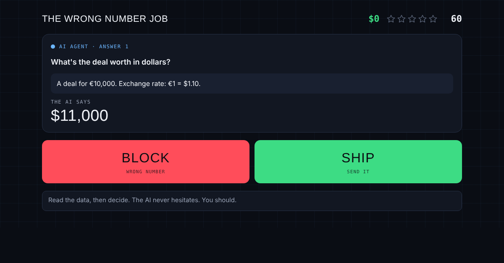
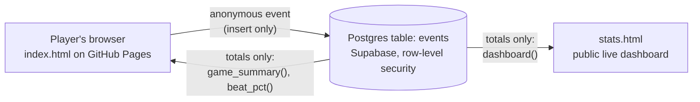

# The Wrong Number Job

**An AI agent is sending numbers to your boss. Some of them are wrong. You have 60 seconds.**

**Play:** https://batrarishab14.github.io/wrong-number-job/ · **Live stats:** https://batrarishab14.github.io/wrong-number-job/stats.html



## How it works
1. Type your job title and get a mission briefing for it (a VP gets "The Board Meeting Job", an engineer gets "The Friday Deploy Job").
2. The AI agent shows you a question, the data, and its answer. **Block** the wrong numbers, **ship** the right ones.
3. Every wrong number you ship earns a wanted star from the audit. Five stars and you're **busted**.
4. At the end you get a rank, how you compare with everyone who has played, a ready-to-post line for LinkedIn, and a review of every trap with the correct math.

## Why
AI agents that query company data rarely crash. They return a confident number that is quietly wrong: a join that double counts, an average of averages, the wrong date column, the wrong units. The game makes you the gate between the AI and the boss, so you see how easy those errors are to miss.

## How it's built
The game is static HTML and JavaScript on GitHub Pages: no framework, no build step, no cookies. Live stats are optional and use a free Supabase (Postgres) project.



- **Insert-only public API.** The page holds Supabase's publishable key, which is meant to be public. Row-level security and column grants let that key add events and nothing else: it can't read, change or delete a row.
- **The database checks every score.** A finished game must add up from its own counts (+100 per wrong number blocked, +50 per right number shipped, −150 per wrong number shipped, −50 per right number blocked), so a hand-made fake score is rejected.
- **Totals only.** The game and the dashboard call three `security definer` functions that return counts, averages and percentiles, never a single row.
- **Source tracking without cookies.** Each visit records where it came from: the `utm_source` in the link, or else the referring site's name (LinkedIn, Reddit, Hacker News and so on). Shared posts carry `utm_source=share`, so the dashboard can show how many visitors came from players' own posts.
- Everything is in [`supabase/setup.sql`](supabase/setup.sql).

### What is stored
| Stored | Never stored |
|---|---|
| A random id per visit (made in the browser, not saved anywhere) | Names, emails, accounts |
| The event (visit, start, finish, copy post, open LinkedIn, suggest a trap, star, open stats) | The job title you type (only the mission type it maps to) |
| The source (`linkedin`, `reddit`, `share`…) | IP addresses, cookies, device details |
| For a finished game: mission type, score, counts, and the ids of the traps you missed | Anything you type anywhere else |

## Turn on live stats (about 10 minutes, free)
The game works without this. Without it, the stats lines and the stats link stay hidden.

1. Go to [supabase.com](https://supabase.com), sign in with GitHub, and create a **New project** on the free plan. Any name (for example `wrong-number-job`), any database password (save it somewhere; you won't need it here), and a region near you.
2. When the project is ready, open **SQL Editor** in the left sidebar, start a new query, paste the whole of `supabase/setup.sql`, and click **Run**.
3. Open **Project Settings → API Keys** and copy the **publishable key** (it starts with `sb_publishable_`). Do **not** use the secret key.
4. Your **project URL** is `https://<project-ref>.supabase.co`, where `<project-ref>` is the code after `/project/` in your browser's address bar while you're in the Supabase dashboard.
5. In this repository on GitHub, open `config.js`, click the pencil icon, paste the two values between the quotes, and click **Commit changes**. GitHub Pages republishes in a minute or two.
6. Check it: play one game, then open `stats.html`. You should see 1 visitor and 1 game.

Notes:
- A free Supabase project pauses after a week with too little activity; real players count as activity. If it pauses, restore it from the Supabase dashboard. The game keeps working while it's paused, just without stats.
- The public key can add events, so someone could send fake but valid-looking rows. Malformed rows and scores that don't add up are rejected. If you ever see junk, delete it in **Table Editor → events**.

## Share links
Use a tagged link per channel so the dashboard shows where players come from:

| Where | Link |
|---|---|
| LinkedIn post | `https://batrarishab14.github.io/wrong-number-job/?utm_source=linkedin` |
| Reddit | `https://batrarishab14.github.io/wrong-number-job/?utm_source=reddit` |
| Hacker News | `https://batrarishab14.github.io/wrong-number-job/?utm_source=hn` |
| X | `https://batrarishab14.github.io/wrong-number-job/?utm_source=x` |
| Friends (WhatsApp, Slack, email) | `https://batrarishab14.github.io/wrong-number-job/?utm_source=friends` |

## Run it on your computer
```
python3 -m http.server 8000
```
Then open http://localhost:8000. (Opening `index.html` straight from disk also works, without live stats.)

## Add a trap
Know a sneaky way AI gets numbers wrong? [Suggest a trap](https://github.com/batrarishab14/wrong-number-job/issues/new?template=trap.yml). Each trap needs the data, the AI's wrong answer, and the right math. The best ones go into the game. All traps live in [`cards.js`](cards.js), one line each.

## Not affiliated
Fan-made, inspired by open-world crime games. Not affiliated with or endorsed by Rockstar Games or Take-Two Interactive. No game art, logos or fonts are used.

## Author
Built by [Rishab Batra](https://github.com/batrarishab14), data and AI architect. MIT licensed.
